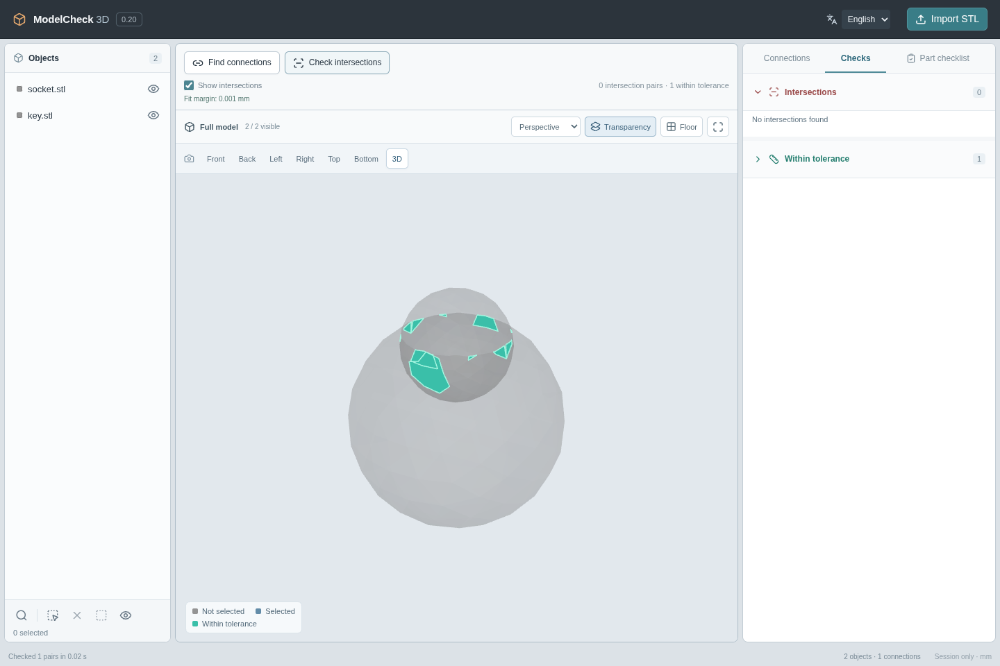
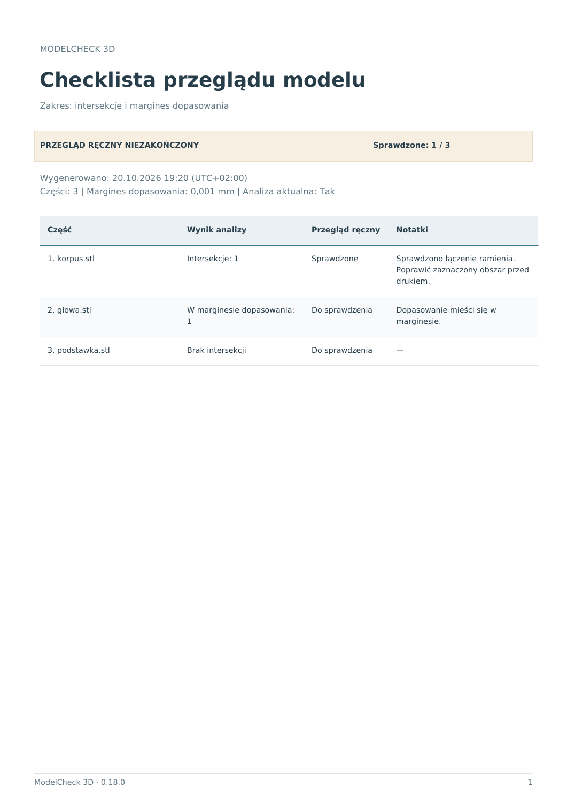
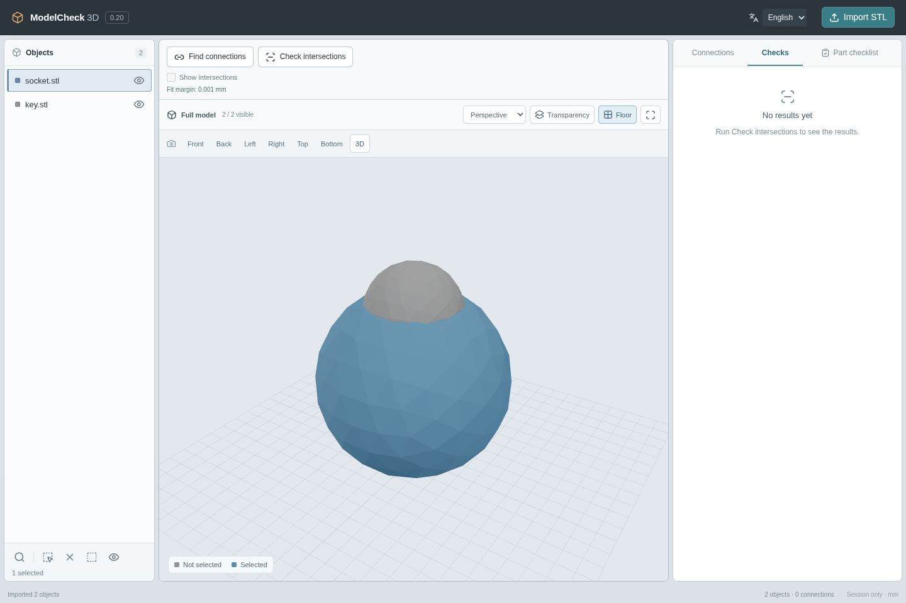

# ModelCheck 3D — prototype 0.20

A local STL assembly viewer for finding directly connected parts and inspecting intersections. The interface defaults to **English**, with a **Polski** option in the top bar. Changing language keeps the current model, selection, results and notes. The language preference is stored in the browser.

[Polish interface preview](docs/polish.png)


## Run on Windows

Requirements: **Python 3.12, 64-bit**, the `py` launcher, and **Node.js 22 or 24** with npm.

1. Download the source ZIP and extract it into a new folder.
2. Run `setup.cmd`. The first installation needs an Internet connection.
3. Run `start.cmd` and use the new browser tab it opens.
4. Leave the server window open. Ctrl+C stops it.

The application header should show **0.20**. Stop the previous server before updating. If its port is still occupied, the launcher chooses an available port and prints the new address. An existing browser tab continues to show its original server.

After installation, the application works offline, including fonts. It listens only on the local computer.

Manual PowerShell commands, from the repository root:

```powershell
py -3.12 -m venv .venv
.venv\Scripts\python.exe -m pip install -r requirements.txt
npm ci --prefix frontend
npm run build --prefix frontend
.venv\Scripts\python.exe run.py
```

The prototype is tested on Linux. The Windows launch scripts and dependency installation still need verification on a Windows computer.

## Workspace

- **Objects, left:** filenames and visibility controls. The bottom toolbar contains Search, Select all, Clear selection, Isolate selection and Show all. Search opens a small field above the toolbar. Hover an icon for its name.
- **3D view, center:** import STL files, orbit the camera and show intersection geometry. Import preserves coordinates and scale: 1 STL unit = 1 mm.
- **Results, right:** Connections, Checks and Part checklist tabs. Selecting a pair highlights both objects; expanding groups or switching tabs leaves selection and camera unchanged.

Colors have one meaning throughout the workspace:

| Color | Meaning |
| --- | --- |
| Matte gray | An unselected object |
| Muted blue | A selected object, from the list, viewport or a pair action |
| Red | An intersection exceeding the fit margin |
| Teal | Computed overlap verified within the 0.001 mm fit margin |
| Purple | Full volume coincidence, in result labels and the analysis overlay |

Selection never changes to a second color for a pair or a coincident object. The viewport legend and object swatches use the same palette. Marking an object reviewed leaves its result color unchanged. Object activation and the tutorial overlay have been removed.


## Connections and intersections

**Find connections** computes informational links between directly connected parts. Connections lists every imported object as a collapsed group, including objects with no links. Expand an object to see only the parts linked to it; opening another group closes the previous one. Expanding or closing a group leaves the 3D selection unchanged. Connected, Within tolerance, Intersection, Needs review and Coincident have different icons and visible labels. Click a linked part to select and highlight both objects without moving the camera. **Inspect** is the single action on each pair: it selects, isolates and frames both objects. The pair name only selects, without moving the camera. Back to full model restores the view.


**Check intersections** creates a review task for every imported object and opens the Checks tab. Results and reviews now have separate tabs:

- **Checks:** separate collapsible sections for Intersections, Needs review and Within tolerance. Actual intersections and uncertain results are shown first. Within tolerance starts collapsed and has its own count. Expand an object to see its related pairs, then Inspect to isolate and frame one. Each section counts pairs once. Expanding a group leaves selection, camera and manual review unchanged.
- **Part checklist, its own tab:** one compact row per imported object, with its result, manual review checkbox and optional notes. Results can be Clear, Within tolerance, an intersection count, Needs review, or Out of date. Clear results are never checked automatically.

**Coincident** identifies two valid solids that occupy the same volume. It is shown in purple in the pair list, part results and intersection overlay. Bounds only identify candidates: both Boolean differences must be empty. Different triangulations of the same solid are accepted; close copies, containment and matching bounds alone are insufficient. This remains an intersection requiring manual review.


**Fit margin: 0.001 mm.** Boolean subtraction can leave tiny overlapping fragments after STL float32 export. These are classified separately as **Within tolerance**, shown in teal when the intersection overlay is enabled, and counted separately from red intersections in both the summary and part checklist. The raw volume and overlap geometry are retained. A fit still requires manual review.

Acceptance checks the entire computed overlap against the surface bands of **both** valid solids using eroded Manifold3D cores. Small volume alone is insufficient: deep thin intrusions, containment and full coincidence keep their intersection classification. A cheap volume/area test rejects obvious candidates but never accepts a fit. The erosion uses an inscribed geodesic sphere, so the check is conservative near the threshold and may retain an intersection there. Numerical failures remain Needs review. The eroded cores are cached per part; the first analysis of a large mesh may take longer. Source positions and geometry remain unchanged.



White contact-area overlays and their switch remain removed. Finding connections updates the results list without changing the 3D view. Red and teal regions appear only after explicitly checking intersections and enabling their overlay. Exact zero-volume contact stays an informational connection; the tolerance does not propose links across gaps.

**Transparency** above the 3D view independently toggles object opacity. It works before analysis and remains separate from the intersection overlay; running a check does not turn transparency on.

The Checks and Part checklist tabs each use the full height of the results panel. The checklist currently contains intersection reviews; other check types will be added later. Notes open inline under their object using the speech-bubble icon. The remaining count and Export PDF button stay at the bottom while the list scrolls.


Both analysis commands always check **all imported objects, including hidden ones**. Selection and isolation change the view only. You can run the intersection check directly; it also calculates connections.

Rerunning a check on the same model preserves manual reviews and notes. Adding or deleting an object marks existing tasks as Out of date, clears their review checkmarks and disables review until the check is rerun. Notes remain. New objects get tasks after the next check.

## Export a review checklist

Open **Part checklist** and click **Export PDF**. The file downloads directly, in the current interface language (English or Polish). It includes every imported part, including hidden parts, in the current object order, with analysis results, manual review state and notes. It also records the generation time with the browser UTC offset, application version, analysis currency and 0.001 mm fit margin.

The PDF explicitly labels the manual review **complete** or **incomplete**. Unrun, missing and out-of-date checks remain pending; stale numerical results are not presented as current. A completed manual review is recorded separately from analysis findings, so red intersections and Needs review results remain visible in a completed checklist. Other check types will be added later.

Export waits for queued review and note saves. A failed save stops the download until the edit succeeds. Reports work offline after setup, with bundled Unicode fonts for Polish filenames and notes. Long notes and lists continue onto additional pages with repeated table headings. This export is a report, not a saved editable project.



## Selection and object order

The object list follows Windows Explorer conventions:

| Action | Result |
| --- | --- |
| Click | Select one object |
| Ctrl + click | Add or remove an object |
| Shift + click | Select a range |
| Ctrl + Shift + click | Add a range |
| Drag from empty list space or its left margin | Draw a selection rectangle |
| Ctrl / Shift while drawing a rectangle | Toggle / add objects |
| Click empty space | Clear selection |
| Ctrl+A while the list has focus | Select all objects matching the search filter |
| Arrows / Home / End | Move selection; Shift extends a range, Ctrl moves focus only |
| Space / Escape | Toggle the focused object / clear selection |
| Drag a filename | Reorder objects; a line marks the insertion point |
| Alt + Up / Down | Reorder the focused object using the keyboard |
| Right click / Shift+F10 | Open the Delete context menu; on a selected object, Delete selected (count) removes the whole selection |
| Delete while the object list has focus | Remove all selected objects |

Deleting several objects is a single atomic operation. Right-clicking an unselected object removes only that object, preserving other selections. The remaining check results become out of date and must be rerun.

The rectangle scrolls the list automatically near its top and bottom edges. Escape during a drag restores the previous selection. Reordering preserves selection, reviews, notes and geometry; it does not rerun analysis. Ranges follow the current manual order and search filter.


**Import STL** stays available throughout the session, including during analysis or another import. Additional files wait in a visible queue until the current operation finishes. An import appends parts, exits isolation, clears the object search and frames the visible model so new objects are visible. Existing selections, explicit visibility settings and note text are retained; previous checks become out of date. The same file can be selected again without refreshing the page.

## Camera and visibility

| Action | Result |
| --- | --- |
| Projection: Perspective / Orthographic | Switch projection while keeping orientation, view center and apparent scale at that center |
| Middle mouse | Orbit around the center of the current view |
| Shift + middle mouse | Pan |
| Wheel | Zoom |
| Click a mesh | Select one object |
| Shift / Ctrl + click a mesh | Add or remove an object |
| Eye icon | Hide or show an object |
| Isolate selection | Show and frame selected objects |
| Show all / Back to full model | Restore and frame all objects |
| Frame all visible / double click in 3D | Frame visible objects |
| Floor | Toggle the subtle floor grid |
| Transparency | Toggle object transparency independently of results |

The camera strip above the scene has **Front, Back, Left, Right, Top, Bottom and 3D** buttons. These preserve the view center, zoom and selected projection. The active direction is highlighted; orbiting freely clears that highlight. The viewport uses a light neutral background, a restrained floor grid and no colored world axes.

| Numpad shortcut | Action |
| --- | --- |
| 1 / Ctrl + 1 | Front / Back |
| 3 / Ctrl + 3 | Right / Left |
| 7 / Ctrl + 7 | Top / Bottom |
| 5 | Switch Perspective / Orthographic |
| 2 / 4 / 6 / 8 | Orbit in 15° steps |
| Decimal | Frame selected objects, or all visible objects when nothing is selected |

These use the physical numpad and work with Num Lock on or off. Camera shortcuts take priority over numpad navigation in the object list; regular arrows, Home and End still navigate the list. Shortcuts are inactive while editing a field or using a select/menu. Both projections support all six directions, framing, picking, orbit, pan, wheel zoom and resizing.

The viewport uses **Soft lighting** only: diffuse, balanced matte shading that follows the camera. Red intersection, teal tolerance and purple coincidence overlays keep their own colors. The floor stays just below the lowest point of the complete imported model, including hidden or isolated parts. Framing a selection changes the camera only. Adding or deleting parts recalculates the floor; hiding or isolating parts does not.



Ordinary selection and clicking a pair name do not move the camera. Pair framing and isolation explicitly change the view. Parts are stationary; prepare geometric variants in Blender. Inspection and camera framing do not transform STL meshes.

## Analysis and limits

- FCL checks surfaces; Manifold3D / Mesh64 computes intersection volumes. Bounding boxes are used only to reject distant pairs.
- Partial overlap, complete containment and disconnected intersection regions are supported. Invalid/open meshes, inconsistent calculations and borderline volumes are marked uncertain.
- Internal connection epsilon: **0.00001 mm**. This is a numerical tolerance, not a manufacturing tolerance. Point and edge contact count as informational connections.
- Tiny computed intersections, at or below max(10⁻¹² mm³, 10⁻¹⁰ of the smaller part's volume), are uncertain unless the fit margin has been verified independently. Automatic repair and reliable detection of all self-intersections are outside this prototype.
- Import limit: **100 MiB per STL**, up to **100 objects** per session. Real-world 100 MB model performance has not yet been measured. Working memory and GPU requirements exceed file sizes.
- Geometry operations run in the background. There is no cancellation for a single long Boolean operation yet.
- **No project saving yet.** Refreshing starts a new session; restarting the server removes session data. Browser language preference is separate and persists locally. Session cleanup on tab closure is best effort.
- Future work: through-gaps, wall thickness, additional checks and project persistence.

## Development and verification

Python + FastAPI + Trimesh + Manifold3D + FCL; React + TypeScript + Three.js.

```bash
python3.12 -m venv .venv
.venv/bin/python -m pip install -r requirements.txt
npm ci --prefix frontend --cache /tmp/modelcheck-npm-cache
npm run build --prefix frontend
.venv/bin/python run.py --no-browser

# Geometry, API and launcher tests
.venv/bin/python -m pytest backend/tests -q

# Browser tests, with the built frontend and backend running
CHROMIUM_PATH=/usr/bin/chromium npm run test:e2e --prefix frontend
```

For frontend development, run `npm run dev --prefix frontend`; Vite proxies `/api` to port 8000. If Chromium is not installed, run `npx playwright install chromium` from `frontend`, and omit `CHROMIUM_PATH` when using Playwright's managed browser.

Tests cover the separate checklist tab, expandable check categories and objects, consistent selection colors, the 0.001 mm fit boundary, rotated and reversed pairs, Boolean sphere/socket roundoff, large shallow overlaps, deep needles, mixed fit/intersection results, manual reviews, PDF downloads and save ordering, complete/incomplete/stale PDF reports, Polish text and multipage notes, informational connections that leave the 3D image unchanged, fitted socket intersections, geometry, imports, selection/ranges, rectangle scrolling, manual reordering, six-direction camera and numpad controls in both projections, editable-field shortcuts, Soft lighting, floor position through framing and model edits, atomic batch deletion, imports queued during analysis and upload, visibility, independent reviews and notes, stale results, context-menu deletion and EN/PL switching and persistence.
