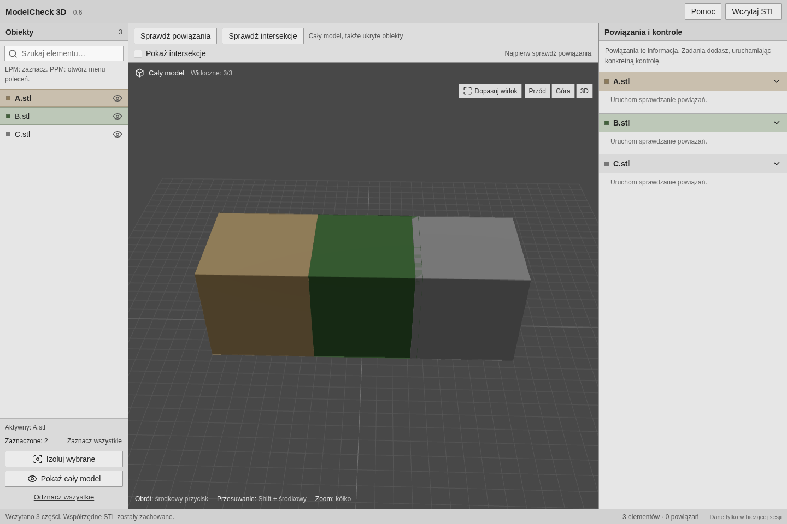

# ModelCheck 3D — prototyp 0.6

Lokalna aplikacja do sprawdzania **powiązań części STL i intersekcji**. Widok 3D działa podobnie do Blendera, a checklista zawiera wszystkie wczytane elementy. Interfejs jest prostym edytorem z systemową czcionką, szarymi panelami i płaskimi przyciskami. Numer wersji 0.6 jest widoczny w nagłówku. Usunięto osobne kategorie styków i szczelin, ich znaczniki oraz próg odległości.


## Windows — uruchomienie

Wymagane: **Python 3.12, 64-bit** z launcherem `py` oraz **Node.js 22 lub 24** z npm.

1. Pobierz ZIP z GitHub: **Code → Download ZIP**. Rozpakuj go do osobnego katalogu.
2. Uruchom `setup.cmd`. Pierwsza instalacja wymaga Internetu.
3. Uruchom `start.cmd`. Aplikacja otworzy się w przeglądarce.
4. Pozostaw okno serwera otwarte. Ctrl+C kończy jego pracę.

**Aktualizacja ze starszej wersji:** zakończ poprzedni serwer klawiszami Ctrl+C w jego oknie, rozpakuj nowy ZIP do osobnego folderu i uruchom w nim `setup.cmd`, a potem `start.cmd`. W nagłówku otwartej aplikacji powinno być **0.6**. Stary działający proces nie wczyta automatycznie nowego silnika analizy.

Aplikacja po instalacji działa bez Internetu; czcionki też są lokalne. Serwer nasłuchuje tylko na tym komputerze, domyślnie na porcie 8000. Gdy port jest zajęty, uruchom `.venv\Scripts\python.exe run.py --port 8001`.

Polecenia ręczne w PowerShell, z katalogu głównego projektu:

```powershell
py -3.12 -m venv .venv
.venv\Scripts\python.exe -m pip install -r requirements.txt
npm ci --prefix frontend
npm run build --prefix frontend
.venv\Scripts\python.exe run.py
```

Pakiety silnika są dostępne dla Windows / Python 3.12 x64. Bieżący prototyp testowano na Linuksie; uruchomienie na Windows pozostaje do sprawdzenia na Twoim komputerze.

## Jak sprawdzić model

1. **Wczytaj STL** — wybierz osobne pliki części lub przeciągnij je do okna. Zachowujemy ich współrzędne i skalę; 1 jednostka STL = 1 mm.
2. **Sprawdź powiązania** — program informuje, które części bezpośrednio się łączą. Lista „Powiązany z” jest wyłącznie informacyjna: nie ma ocen OK, notatek do par ani obowiązku odhaczania połączeń. Kliknięcie pary pozwala obejrzeć ją w izolacji. Wszystkie wczytane elementy pozostają na liście, również bez połączeń.
3. **Sprawdź intersekcje** — uruchamia konkretną kontrolę. Dopiero wtedy przy każdym elemencie pojawia się zadanie **Intersekcje sprawdzone**. Wynik mówi o wykrytych intersekcjach, ich braku lub niepewności. Żadne zadanie nie odhacza się automatycznie.
4. Po ręcznej kontroli elementu odhacz jego zadanie. **Szczegóły** otwierają wynik i notatkę dotyczącą kontroli tego elementu. Każdy element ma własne zadanie; sprawdzenie B nie odhacza C.
5. **Pokaż intersekcje** zmienia tylko widoczność wyników już uruchomionej kontroli. Czerwona, matowa geometria pokazuje wspólną objętość. Otaczające części są przezroczyste, by odsłonić wnętrze. Samo przełączanie widoczności nie tworzy dodatkowych zadań.
6. **Pokaż cały model** przywraca wszystkie części i dopasowuje kamerę do całości.

Oba polecenia analizy obejmują zawsze cały model, również ukryte części. Zaznaczenie i izolacja wpływają tylko na widok. Możesz od razu uruchomić **Sprawdź intersekcje**, bez osobnego uruchamiania powiązań — kontrola uzupełni również tę informację.

Ponowne uruchomienie kontroli na niezmienionych danych zachowuje odhaczenia i notatki. Dodanie lub usunięcie części oznacza wcześniejsze zadania jako **nieaktualne**, usuwa ich odhaczenia i blokuje ponowne odhaczanie do czasu uruchomienia kontroli. Notatki istniejących elementów pozostają. Nowy element otrzyma zadanie dopiero po uruchomieniu kontroli.

W pustym widoku dostępny jest przykład A/B/C: A łączy się z B, B z C, B–C mają intersekcję, A i C są rozdzielone.

## Menu obiektu i kolory

Prawy przycisk na lewej liście **tylko otwiera menu**. Polecenia są sortowane alfabetycznie:

- **Aktywuj** — ustawia aktywny obiekt, beżowy również w 3D.
- **Usuń** — usuwa wskazaną część z bieżącego modelu; jest niedostępne podczas przetwarzania.

Samo otwarcie lub zamknięcie menu nie zmienia aktywnego obiektu. Shift+F10 otwiera to samo menu; strzałki, Home i End wybierają pozycję, Enter wykonuje polecenie, Escape zamyka menu.

Lewy przycisk zaznacza, Shift + klik dodaje lub odejmuje części. Nie aktywuje obiektu. Aktywacja pozostaje niezależna od zaznaczenia; usunięcie aktywnego obiektu nie aktywuje następnego.

| Stan obiektu | Kolor |
| --- | --- |
| Nieaktywny i niezaznaczony | Ciemnoszary |
| Nieaktywny i zaznaczony | Przygaszony zielony |
| Aktywny | Ciemny beż |

Materiały mają maksymalną chropowatość, bez metaliczności. Oświetlenie i odwzorowanie tonalne ograniczają jaskrawość; intersekcje pozostają matowo czerwone.



## Sterowanie

| Sterowanie | Działanie |
| --- | --- |
| Środkowy przycisk myszy | Obrót kamery |
| Shift + środkowy przycisk | Przesuwanie widoku |
| Kółko | Zoom |
| Klik w model lub nazwę | Wybór elementu |
| Shift / Ctrl + klik | Wiele elementów |
| Ikona oka | Ukrywanie i pokazywanie części |
| Prawy przycisk na liście | Menu „Aktywuj”, „Usuń” |
| Izoluj wybrane | Widok samych zaznaczonych części |
| Dopasuj widok / dwuklik | Dopasowanie kamery |

Części są nieruchome; warianty geometrii przygotuj w Blenderze.

## Zasady analizy i ograniczenia

- Lista powiązań wynika z rzeczywistej geometrii. AABB służy tylko do odrzucania dalekich par. FCL sprawdza powierzchnie, a Manifold3D / Mesh64 oblicza wspólną objętość brył.
- Obsługujemy częściowe przenikanie, całkowite zawieranie oraz wiele rozłącznych regionów intersekcji. Nieprawidłowa siatka, błąd obliczeń lub wynik graniczny otrzymują **Wymaga weryfikacji**. Takiej pary nie opisujemy jako pewnego powiązania.
- Wewnętrzna tolerancja obliczeniowa bezpośredniego połączenia to 0,00001 mm. Nie jest tolerancją produkcyjną. Punktowy i krawędziowy kontakt też trafia na informacyjną listę powiązań. Poprawność technologiczna nie jest oceniana automatycznie.
- Skrajnie małe objętości przecięcia (≤ max(10⁻¹² mm³, 10⁻¹⁰ objętości mniejszej części)) są niepewne. Nie gwarantujemy wykrycia wszystkich samoprzecięć i wad topologii. Nie naprawiamy automatycznie siatek; scalanie powtarzających się wierzchołków wykonujemy na kopii roboczej, bez przesuwania współrzędnych.
- Limit importu: 100 MiB na plik i 100 części na sesję. Wydajność rzeczywistych modeli 100 MB nie została jeszcze zmierzona. Pamięć potrzebna na obliczenia i GPU jest większa niż rozmiar samego STL.
- Analiza działa w tle z licznikiem par. Nie ma jeszcze anulowania pojedynczej długiej operacji Boolean.
- **Brak zapisu projektu.** Odświeżenie strony zaczyna nową sesję; restart serwera usuwa dane. Zwalnianie opuszczonej sesji po zamknięciu strony jest wykonywane w miarę możliwości przeglądarki; w razie potrzeby zrestartuj serwer, aby odzyskać pamięć po dużych testach.
- Poza tą iteracją: kontrola prześwitu na wylot, pomiary grubości, automatyczna ocena CNC, ręczne dodawanie powiązań, edycja geometrii i zapis projektów.

## Rozwój i testy

Python + FastAPI + Trimesh + Manifold3D + FCL; frontend React + TypeScript + Three.js.

```bash
# Linux / macOS, katalog główny repozytorium
python3.12 -m venv .venv
.venv/bin/python -m pip install -r requirements.txt
npm ci --prefix frontend
npm run build --prefix frontend
.venv/bin/python run.py

# Backend w trybie deweloperskim, osobny terminal
.venv/bin/python -m uvicorn backend.main:app --reload --host 127.0.0.1 --port 8000
# Frontend w osobnym terminalu; proxy do backendu na porcie 8000
npm run dev --prefix frontend

# Geometria i API
.venv/bin/python -m pytest backend/tests -q
```

Na Windows zastąp `.venv/bin/python` przez `.venv\Scripts\python.exe`.

Testy przeglądarkowe wymagają uruchomionego backendu z wcześniej zbudowanym frontendem:

```bash
cd frontend
npx playwright install chromium
npm run test:e2e
```

Możesz wskazać istniejący Chromium zmienną `CHROMIUM_PATH`. Testy obejmują analizę powiązań i intersekcji, zawieranie, wiele regionów, odseparowane i nieprawidłowe siatki, zachowanie współrzędnych, import, kamerę, izolację, checklistę, informacyjny charakter powiązań, tworzenie zadań wyłącznie po uruchomieniu kontroli, nieaktualność po zmianach modelu, alfabetyczne menu oraz analizę całego modelu.
