# ModelCheck 3D — prototype 0.25

A local STL assembly viewer for finding directly connected parts and inspecting intersections. The interface defaults to **English**, with a **Polski** option in the top bar. Changing language keeps the current model, selection, results and notes. The language preference is stored in the browser.

[Polish interface preview](docs/polish.png)

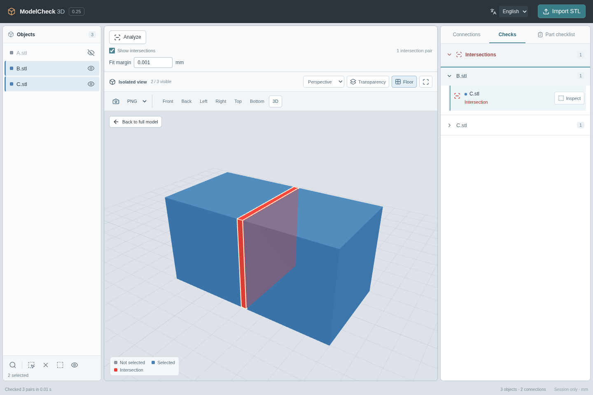

## Run on Windows — portable ZIP

Download **[ModelCheck3D-Windows-x64.zip](https://github.com/mypaaw-commits/aaa/releases/latest/download/ModelCheck3D-Windows-x64.zip)** from Releases.

1. Extract the **complete ZIP** to a new folder.
2. Double-click **ModelCheck3D.exe**. Your browser opens the application.
3. Keep the program window open while working; close it when finished.

**No Python, Node.js, setup.cmd or dependency installation is needed.** The ZIP contains the runtime, native geometry libraries, built interface and PDF fonts. Keep `_internal` beside the executable. Windows 10/11 x64 is the target platform. The GitHub **Source code** archives are for development and are not the portable application.

To update, close the previous copy, extract the new ZIP into a new folder and run the new executable. The header should show **0.25**. If an older copy still occupies its port, the launcher chooses a free port and opens the corresponding browser tab.

After downloading, the application works offline and listens only on the local computer. Models, analysis results and notes remain in the current session; close/restart removes the session. The portable package changes distribution and startup; the geometric analysis behavior is described below.

### Run from source

For development, install **Python 3.12 x64** and **Node.js 22 or 24**, download the source ZIP, then run `setup.cmd` followed by `start.cmd`. These steps are unnecessary for the portable ZIP.

Manual PowerShell commands from the repository root:

```powershell
py -3.12 -m venv .venv
.venv\Scripts\python.exe -m pip install -r requirements.txt
npm ci --prefix frontend
npm run build --prefix frontend
.venv\Scripts\python.exe run.py
```

## Workspace

- **Objects, left:** filenames and visibility controls. The bottom toolbar contains Search, Select all, Clear selection, Isolate selection and Show all. Search opens a small field above the toolbar. Hover an icon for its name.
- **3D view, center:** import STL files, orbit the camera and show intersection geometry. Import preserves coordinates and scale: 1 STL unit = 1 mm.
- **Results, right:** Connections, Checks and Part checklist tabs. Selecting a pair highlights both objects; expanding groups or switching tabs leaves selection and camera unchanged.

Colors have one meaning throughout the workspace:

| Color | Meaning |
| --- | --- |
| Cool matte gray | An unselected object |
| Clear matte blue | A selected object, from the list, viewport or a pair action |
| Red | An intersection exceeding the fit margin |
| Teal | Computed overlap verified within the 0.001 mm fit margin |
| Purple | Full volume coincidence, in result labels and the analysis overlay |

Selection never changes to a second color for a pair or a coincident object. The viewport legend and object swatches use the same palette. Marking an object reviewed leaves its result color unchanged. Object activation and the tutorial overlay have been removed.

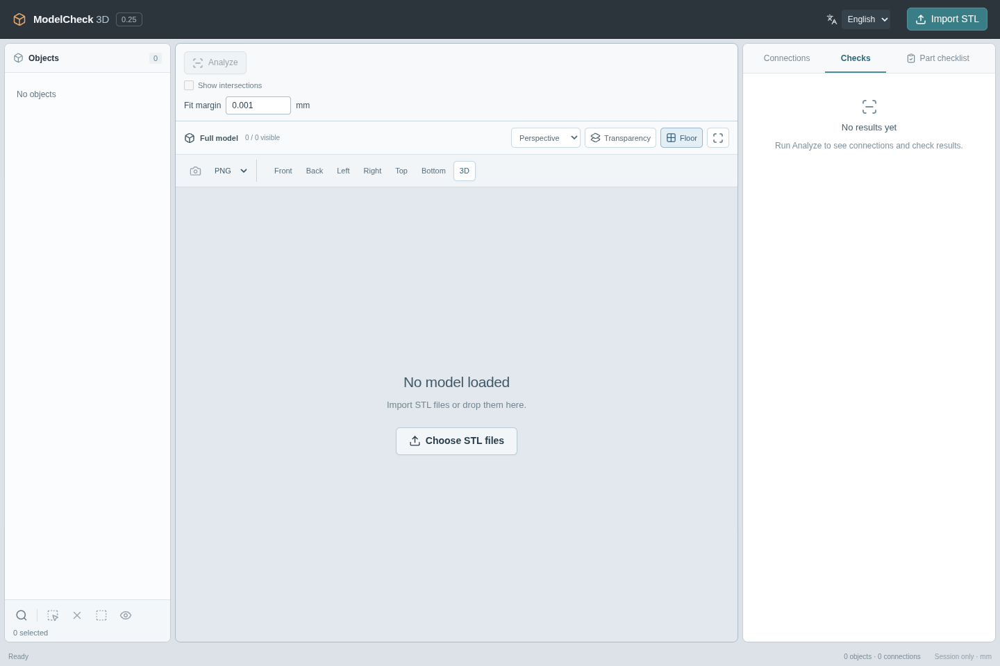

## Connections and intersections

**Analyze** runs one complete analysis of all imported parts, including hidden parts: direct connections, intersections, fits within 0.001 mm, coincidence and uncertain results. It refreshes the part checklist, opens Checks and enables the intersection overlay. Connections remain informational; manual review checkboxes remain unchecked until the user completes them.

The **Connections** tab lists informational links between directly connected parts. Connections lists every imported object as a collapsed group, including objects with no links. Expand an object to see only the parts linked to it; opening another group closes the previous one. Expanding or closing a group leaves the 3D selection unchanged. Connected, Within tolerance, Intersection, Needs review and Coincident have different icons and visible labels. Click a linked part to select and highlight both objects without moving the camera. **Inspect** is the single action on each pair: it selects, isolates and frames both objects. The pair name only selects, without moving the camera. Back to full model restores the view.

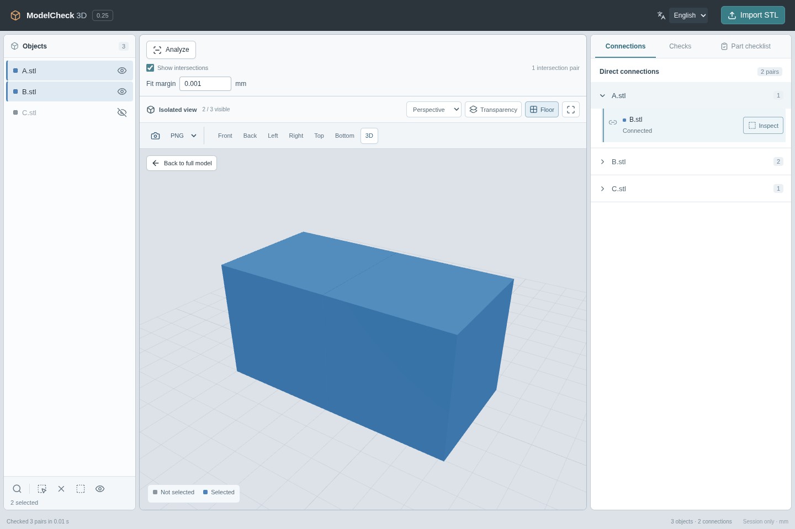

**Analyze** also creates or refreshes a review task for every imported object. Results and reviews now have separate tabs:

- **Checks:** separate collapsible sections for Intersections, Needs review and Within tolerance. Actual intersections and uncertain results are shown first. Within tolerance starts collapsed and has its own count. Expand an object to see its related pairs, then Inspect to isolate and frame one. Each section counts pairs once. Expanding a group leaves selection, camera and manual review unchanged.
- **Part checklist, its own tab:** one compact row per imported object, with its result, manual review checkbox and optional notes. Results can be Clear, Within tolerance, an intersection count, Needs review, or Out of date. Clear results are never checked automatically.

**Coincident** identifies two valid solids that occupy the same volume. It is shown in purple in the pair list, part results and intersection overlay. Bounds only identify candidates: both Boolean differences must be empty. Different triangulations of the same solid are accepted; close copies, containment and matching bounds alone are insufficient. This remains an intersection requiring manual review.

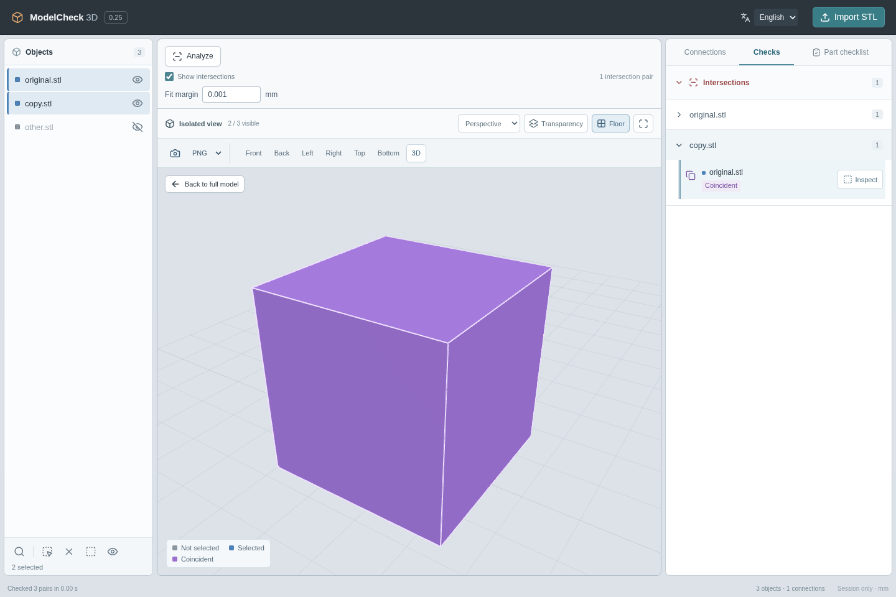

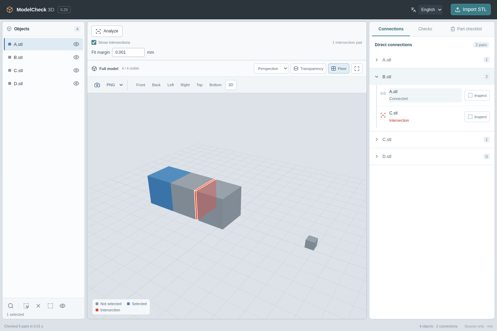

**Fit margin: 0.001 mm by default, editable from 0 to 10 mm.** Change the field below Analyze and press Enter or leave it to apply. Decimal dots and Polish decimal commas are accepted. Zero disables the fit allowance. Changing the value clears the previous pair findings and marks checklist reviews out of date while preserving notes; Analyze computes new findings with the saved value. Repeating the same value leaves reviews and cached results intact. The PDF uses the session's saved margin.

 Boolean subtraction can leave tiny overlapping fragments after STL float32 export. These are classified separately as **Within tolerance**, shown in teal when the intersection overlay is enabled, and counted separately from red intersections in both the summary and part checklist. The raw volume and overlap geometry are retained. A fit still requires manual review.

Acceptance checks the entire computed overlap against the surface bands of **both** valid solids using eroded Manifold3D cores. Small volume alone is insufficient: deep thin intrusions, containment and full coincidence keep their intersection classification. A cheap volume/area test rejects obvious candidates but never accepts a fit. The erosion uses an inscribed geodesic sphere, so the check is conservative near the threshold and may retain an intersection there. Numerical failures remain Needs review. Smaller-source eroded cores are cached per part. For dense sources, an inconclusive certificate now produces Needs review instead of attempting the costly whole-source erosion. Source positions and geometry remain unchanged.

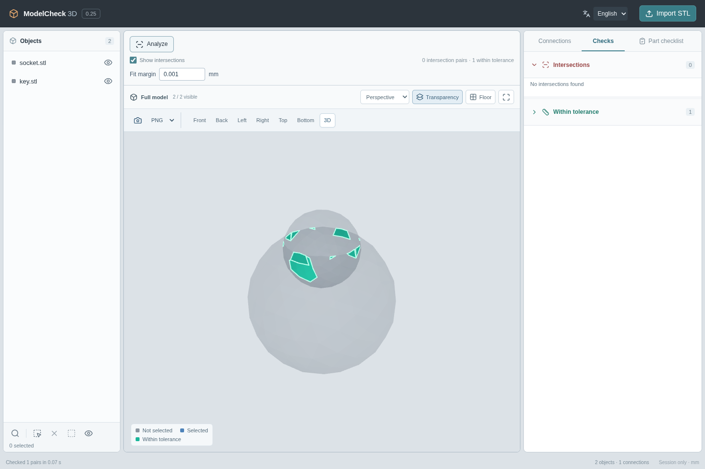

White contact-area overlays and their switch remain removed. Finding connections updates the results list without changing the 3D view. Red and teal regions appear only after explicitly checking intersections and enabling their overlay. Exact zero-volume contact stays an informational connection; the tolerance does not propose links across gaps.

**Transparency** above the 3D view independently toggles object opacity. It works before analysis and remains separate from the intersection overlay; running a check does not turn transparency on.

The Checks and Part checklist tabs each use the full height of the results panel. The checklist currently contains intersection reviews; other check types will be added later. Notes open inline under their object using the speech-bubble icon. The remaining count and Export PDF button stay at the bottom while the list scrolls.

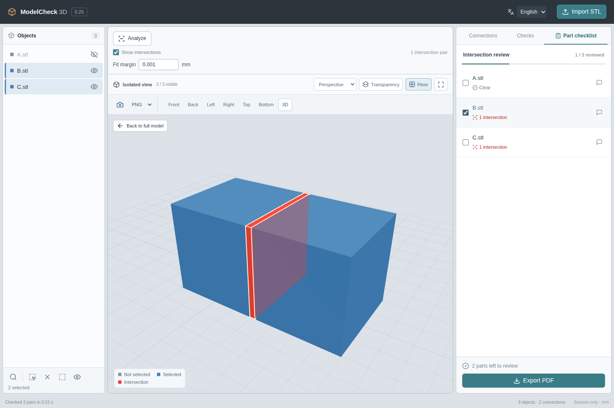

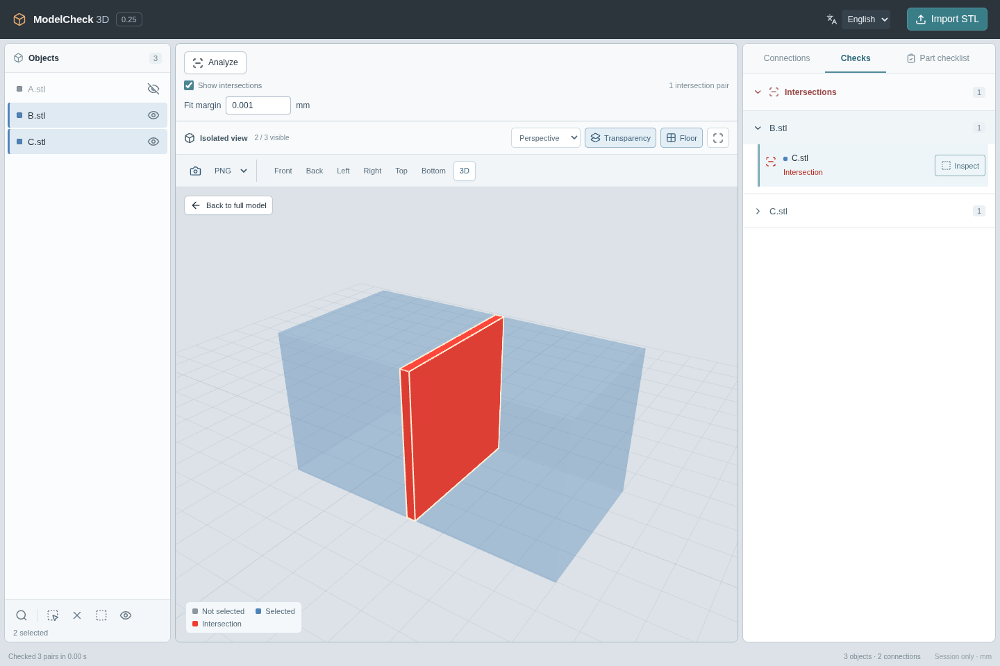

Both analysis commands always check **all imported objects, including hidden ones**. Selection and isolation change the view only. You can run the intersection check directly; it also calculates connections.

Rerunning a check on the same model preserves manual reviews and notes. Adding or deleting an object marks existing tasks as Out of date, clears their review checkmarks and disables review until the check is rerun. Notes remain. New objects get tasks after the next check.

## Export a review checklist

Open **Part checklist** and click **Export PDF**. The file downloads directly, in the current interface language (English or Polish). It includes every imported part, including hidden parts, in the current object order, with analysis results, manual review state and notes. It also records the generation time with the browser UTC offset, application version, analysis currency and 0.001 mm fit margin.

The PDF explicitly labels the manual review **complete** or **incomplete**. Unrun, missing and out-of-date checks remain pending; stale numerical results are not presented as current. A completed manual review is recorded separately from analysis findings, so red intersections and Needs review results remain visible in a completed checklist. Other check types will be added later.

Export waits for queued review and note saves. A failed save stops the download until the edit succeeds. Reports work offline after setup, with bundled Unicode fonts for Polish filenames and notes. Long notes and lists continue onto additional pages with repeated table headings. This export is a report, not a saved editable project.

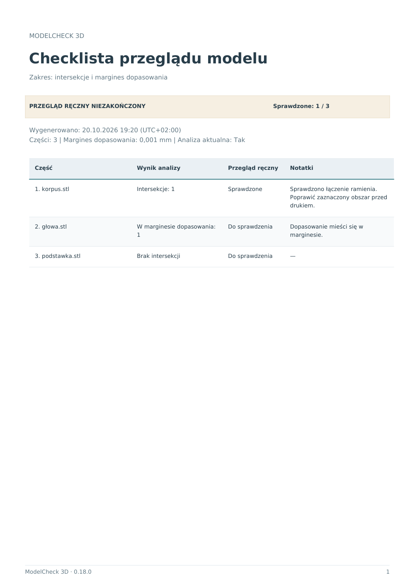

## Selection and object order

The object list follows Windows Explorer conventions:

| Action | Result |
| --- | --- |
| Click | Select one object |
| Ctrl + click | Add or remove an object |
| Shift + click | Select a range |
| Ctrl + Shift + click | Add a range |
| Drag from empty list space or its left margin | Draw a selection rectangle |
| Ctrl / Shift while drawing a rectangle | Toggle / add objects |
| Click empty space | Clear selection |
| Ctrl+A while the list has focus | Select all objects matching the search filter |
| Arrows / Home / End | Move selection; Shift extends a range, Ctrl moves focus only |
| Space / Escape | Toggle the focused object / clear selection |
| Drag a filename | Reorder objects; a line marks the insertion point |
| Alt + Up / Down | Reorder the focused object using the keyboard |
| Right click / Shift+F10 | Open the Delete context menu; on a selected object, Delete selected (count) removes the whole selection |
| Delete while the object list has focus | Remove all selected objects |

Deleting several objects is a single atomic operation. Right-clicking an unselected object removes only that object, preserving other selections. The remaining check results become out of date and must be rerun.

The rectangle scrolls the list automatically near its top and bottom edges. Escape during a drag restores the previous selection. Reordering preserves selection, reviews, notes and geometry; it does not rerun analysis. Ranges follow the current manual order and search filter.

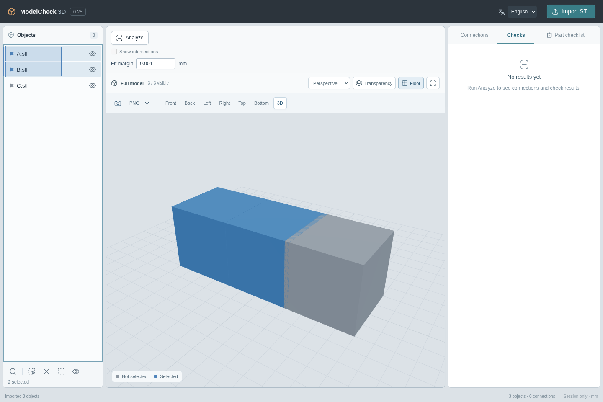

**Import STL** stays available throughout the session, including during analysis or another import. Additional files wait in a visible queue until the current operation finishes. An import appends parts, exits isolation, clears the object search and frames the visible model so new objects are visible. Existing selections, explicit visibility settings and note text are retained; previous checks become out of date. The same file can be selected again without refreshing the page.

## Camera and visibility

| Action | Result |
| --- | --- |
| Projection: Perspective / Orthographic | Switch projection while keeping orientation, view center and apparent scale at that center |
| Middle mouse | Orbit around the center of the current view |
| Shift + middle mouse | Pan |
| Wheel | Zoom |
| Click a mesh | Select one object |
| Shift / Ctrl + click a mesh | Add or remove an object |
| Eye icon | Hide or show an object |
| Isolate selection | Show and frame selected objects |
| Show all / Back to full model | Restore and frame all objects |
| Frame all visible / double click in 3D | Frame visible objects |
| Floor | Toggle the subtle floor grid |
| Transparency | Toggle object transparency independently of results |

The camera strip above the scene has **Front, Back, Left, Right, Top, Bottom and 3D** buttons. These preserve the view center, zoom and selected projection. The active direction is highlighted; orbiting freely clears that highlight. The viewport uses a light neutral background, a restrained floor grid and no colored world axes.

| Numpad shortcut | Action |
| --- | --- |
| 1 / Ctrl + 1 | Front / Back |
| 3 / Ctrl + 3 | Right / Left |
| 7 / Ctrl + 7 | Top / Bottom |
| 5 | Switch Perspective / Orthographic |
| 2 / 4 / 6 / 8 | Orbit in 15° steps |
| Decimal | Frame selected objects, or all visible objects when nothing is selected |

These use the physical numpad and work with Num Lock on or off. Camera shortcuts take priority over numpad navigation in the object list; regular arrows, Home and End still navigate the list. Shortcuts are inactive while editing a field or using a select/menu. Both projections support all six directions, framing, picking, orbit, pan, wheel zoom and resizing.

The viewport uses **Soft lighting** only: diffuse, balanced matte shading that follows the camera. Red intersection, teal tolerance and purple coincidence overlays keep their own colors. The floor stays just below the lowest point of the complete imported model, including hidden or isolated parts. Framing a selection changes the camera only. Adding or deleting parts recalculates the floor; hiding or isolating parts does not.

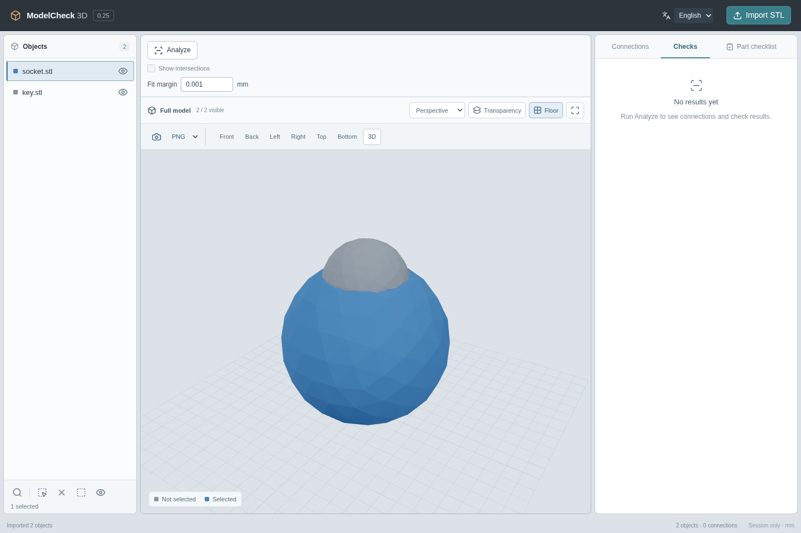

Ordinary selection and clicking a pair name do not move the camera. Pair framing and isolation explicitly change the view. Parts are stationary; prepare geometric variants in Blender. Inspection and camera framing do not transform STL meshes.

## Viewport screenshots

The camera icon beside the view buttons downloads the current 3D viewport.
**PNG is the default**, with **JPEG** and **WebP** available in the adjacent
format selector. PNG preserves the image without compression loss. The exported
image includes the current projection, camera, visibility/isolation,
transparency, floor and result highlights, without the surrounding application
panels. Its resolution matches the viewport drawing buffer. Export waits for
result overlays to finish loading and does not change the camera or selection.

Parts use a cooler gray and a stronger selection blue. Intersection surfaces
use a saturated red with shading and light edges; a faint X-ray layer identifies
hidden overlap while the visible surface stays distinct. Verified fits remain
teal and coincidence remains purple. The model geometry and result geometry are
not simplified for this display.

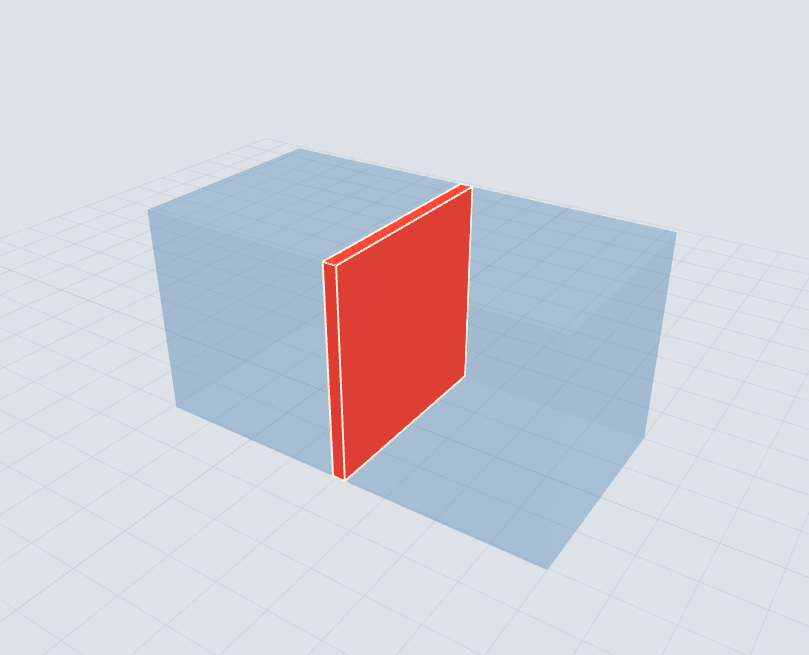

## Analysis performance

Since 0.22, import reads the existing multipart spool directly, creates extra surface hierarchies only when needed, releases large validation scratch arrays, and streams STL exports in bounded chunks. Dense near-margin pairs use exact small solid witnesses and additional kernel directions. In 0.23, surface distance reuses Manifold's existing hierarchy, avoiding the extra FCL copies altogether. These optimizations preserve original coordinates and the same geometric tolerance. Version 0.23 does not run the costly whole-source erosion on sources with at least 50,000 faces: if the certificates cannot resolve the margin, the pair remains **Needs review**, never Clear or Within tolerance.

The analysis speeds up the fit-margin test without simplifying or moving imported meshes. A conservative geometric certificate handles typical shallow STL/Boolean roundoff; smaller cases it cannot certify still use the original erosion test. The default margin is 0.001 mm; the editable session setting is used consistently in classification, caching and reports.

Unchanged pairs reuse their geometry result across successive analyses, including intersection overlays. Importing a part computes only its new pairs. Deleting another part, visibility, selection, list ordering and manual reviews leave the pair geometry unchanged. Uncertain results are retried. Manual checklists still require explicit review, and model edits still make existing reviews out of date.

On a generated STL sphere/socket pair with 13,648 triangles, a measured cold analysis went from **16.75 s to 0.071 s**. A larger pair with 212,232 triangles took about **1.28 s** in the new version. Timings exclude fixture generation/import and browser polling and depend on geometry and hardware. Those historical measurements compare 0.20 and 0.21. Current dense cases that cannot be certified are explicitly marked Needs review instead of starting an unbounded whole-source erosion.

Version 0.23 also reduced the surface-contact analysis of two generated 125 MiB STL files from 18.68 s to 0.94 s, with peak process RSS decreasing from 4.31 GiB to 2.62 GiB. This excludes preparation and measures contact, not arbitrary positive-volume intersections.

[Method, measurements and reproducible benchmark](docs/analysis-performance.md)

```bash
.venv/bin/python -m backend.benchmark_analysis --subdivisions 4
.venv/bin/python -m backend.benchmark_analysis --subdivisions 6
```

## Analysis and limits

- Manifold3D / Mesh64 computes intersection volumes and reuses its existing solid hierarchy for capped surface-distance queries. Bounding boxes are used only to reject distant pairs.
- Partial overlap, complete containment and disconnected intersection regions are supported. Invalid/open meshes, inconsistent calculations and borderline volumes are marked uncertain.
- Internal connection epsilon: **0.00001 mm**. This is a numerical tolerance, not a manufacturing tolerance. Point and edge contact count as informational connections.
- Tiny computed intersections, at or below max(10⁻¹² mm³, 10⁻¹⁰ of the smaller part's volume), are uncertain unless the fit margin has been verified independently. Automatic repair and reliable detection of all self-intersections are outside this prototype.
- Import limit: **200 MiB per STL**, up to **100 objects** per session. Binary STL at this limit contains about 4.19 million triangles. Generated STL files of 131,072,084 and 205,845,284 bytes were imported and analyzed together through the API (about 28 s cold, under 0.01 s reused on the test host). Browser rendering time for those large files has not been measured. Large meshes require several GB of RAM; available memory and GPU resources still limit a practical session.
- Geometry operations run in the background. The running analysis shows its actual stage and elapsed time and offers **Stop analysis**. Cancellation is cooperative; the UI remains busy until the worker actually stops. A cancelled run preserves the previous complete findings and reviews. Native Boolean evaluation receives a cancellation context. A 90 s pair budget and 45 s fit-verification budget request cancellation; these are not hard wall-clock guarantees for native calls; a stop is not a forced process termination. Computation limits produce **Needs review**, with an explanation in Checks and a corresponding uncertain result in the checklist/PDF.
- **No project saving yet.** Refreshing starts a new session; restarting the server removes session data. Browser language preference is separate and persists locally. Session cleanup on tab closure is best effort.
- Future work: through-gaps, wall thickness, additional checks and project persistence.

## Development and verification

Python + FastAPI + Trimesh + Manifold3D; React + TypeScript + Three.js.

```bash
python3.12 -m venv .venv
.venv/bin/python -m pip install -r requirements.txt
npm ci --prefix frontend --cache /tmp/modelcheck-npm-cache
npm run build --prefix frontend
.venv/bin/python run.py --no-browser

# Geometry, API and launcher tests
.venv/bin/python -m pytest backend/tests -q

# Browser tests, with the built frontend and backend running
CHROMIUM_PATH=/usr/bin/chromium npm run test:e2e --prefix frontend
```

For frontend development, run `npm run dev --prefix frontend`; Vite proxies `/api` to port 8000. If Chromium is not installed, run `npx playwright install chromium` from `frontend`, and omit `CHROMIUM_PATH` when using Playwright's managed browser.

Tests cover the separate checklist tab, expandable check categories and objects, consistent selection colors, dense fit certificates and exact fallback, cached pair reuse and invalidation, the 0.001 mm fit boundary, rotated and reversed pairs, Boolean sphere/socket roundoff, large shallow overlaps, deep needles, mixed fit/intersection results, manual reviews, PDF downloads and save ordering, complete/incomplete/stale PDF reports, Polish text and multipage notes, informational connections that leave the 3D image unchanged, fitted socket intersections, geometry, direct spooled imports, bounded STL streaming, reused native surface queries, analysis cancellation/limits, unified analysis, imports, selection/ranges, rectangle scrolling, manual reordering, six-direction camera and numpad controls in both projections, editable-field shortcuts, Soft lighting, floor position through framing and model edits, atomic batch deletion, imports queued during analysis and upload, visibility, independent reviews and notes, stale results, context-menu deletion and EN/PL switching and persistence.


## Build and verify a portable release

Build on the target operating system with 64-bit Python 3.12:

```powershell
python -m pip install -r packaging/requirements-build.txt
npm ci --prefix frontend
npm run build --prefix frontend
python scripts/build_portable.py
python scripts/smoke_portable.py release/ModelCheck3D-Windows-x64.zip
```

PyInstaller builds a directory distribution to avoid unpacking the runtime on every launch. `scripts/build_portable.py` includes fonts, the compiled frontend, Python license, dependency metadata/licenses and `BUILD-INFO.json`, then creates the ZIP and a SHA-256 checksum. `scripts/smoke_portable.py` extracts the actual ZIP into a directory with spaces, starts it from an unrelated working directory with Python/Node removed from PATH, checks the frontend and assets, imports real STL files, computes a native intersection and a .001 mm fit, downloads both STL representations, exports English and Polish PDFs, then changes the fit margin to zero and verifies reclassification.

`.github/workflows/windows-portable.yml` builds and tests on Windows x64 when a `v*` tag is pushed. It checks that the tag matches the frontend version, then publishes the verified ZIP and checksum as a GitHub Release. A manual workflow run builds an artifact without publishing a release. Tagged releases must bump the application version first. Source archives are not substituted if the executable build fails.

The same build/smoke scripts support Linux x64 for local packaging validation, using `ModelCheck3D-Linux-x64.zip`. A Linux build is not a Windows executable; the Windows release is built and tested by its Windows job.
