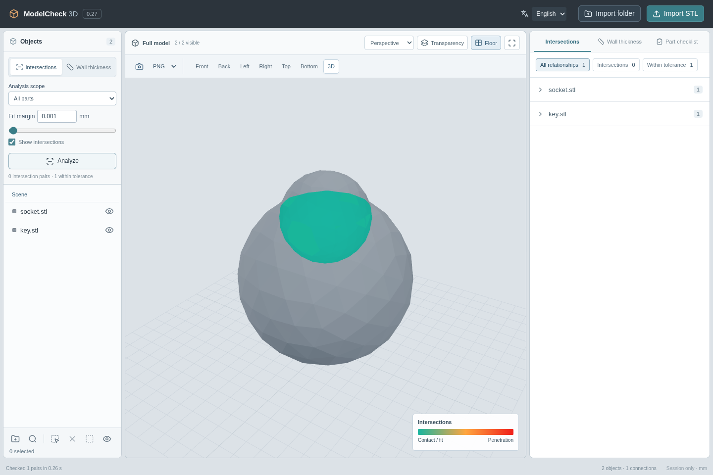
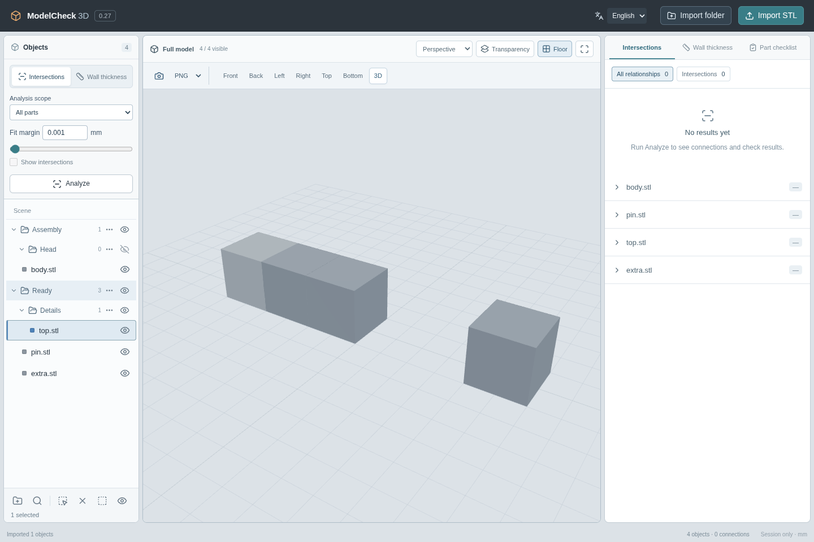
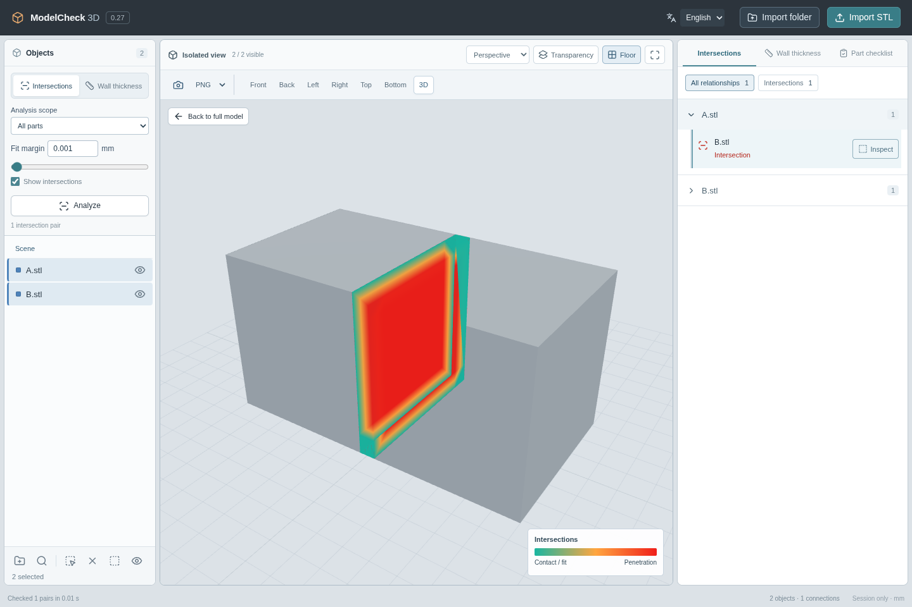
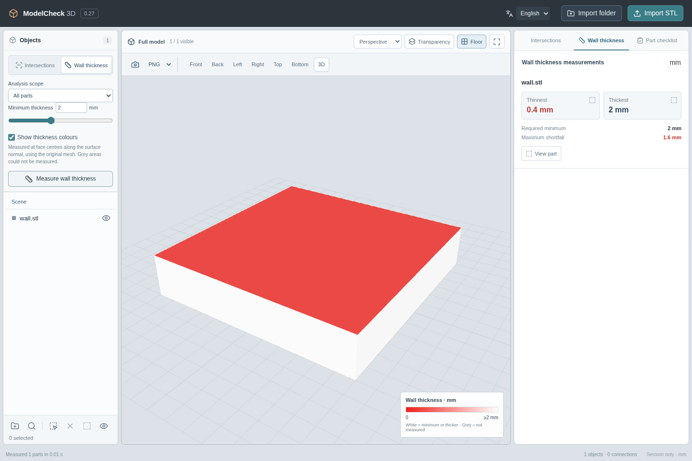
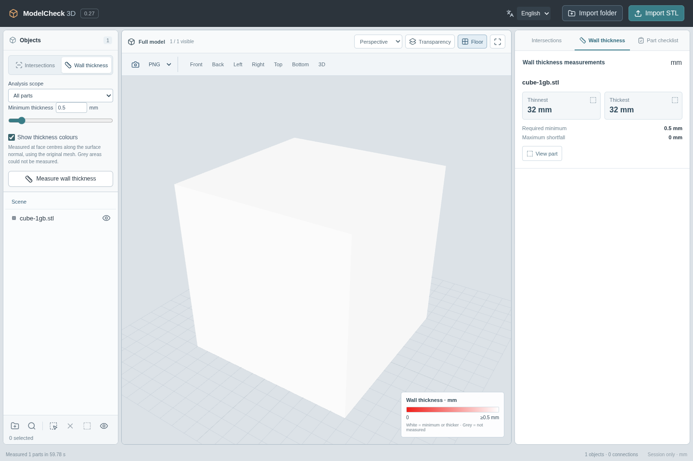

# ModelCheck 3D — prototype 0.27

A local STL assembly viewer with separate intersection and wall-thickness checks. Coordinates are in **millimetres**: 1 STL unit = 1 mm. The interface defaults to English; choose Polski in the header to change language.



## Run on Windows

Download **[ModelCheck3D-Windows-x64.zip](https://github.com/mypaaw-commits/aaa/releases/latest/download/ModelCheck3D-Windows-x64.zip)**.

1. Extract the complete ZIP into a new folder.
2. Run **ModelCheck3D.exe** and keep its window open while working.
3. The browser opens the application; the header should show **0.27**.

The portable ZIP contains Python, native libraries, compiled UI and PDF fonts. No Python/Node installation is required. Keep `_internal` beside the executable. Windows 10/11 x64 is the target. GitHub's Source code archives are development files.

Models stay on the local computer. Models, folders and reviews belong to the current session; refreshing or closing/restarting starts a new session. Project saving is not implemented yet.

## Import and organize

**Import STL** appends files at any time. **Import folder** imports STL files recursively and recreates the directory structure, including its root name. Other file types are ignored by the folder picker. A selected folder is the destination for subsequent imports. Choose Scene to return to the root.

The object list supports:

- New folders and subfolders, rename, move and recursive deletion through the context menu.
- Drag parts or selected groups into folders; drag folders into other folders. Drop on the empty list/Scene area to move to the root. The context menu also provides Move to folder.
- Collapse/expand folders, search filenames or folder paths, and group visibility. Collapsing a folder changes the list only.
- Folder F2/rename, Delete and context-menu keys; arrows navigate or expand/collapse.
- File click/Ctrl-click/Shift-click, Ctrl+A, keyboard ranges, rectangle selection, Delete selected, filename reordering and Alt+Up/Down.

Deleting a folder removes its imported objects from the session. Original files on disk are unchanged. Folder changes, visibility and ordering do not alter geometry or invalidate measurements. Adding/deleting actual parts invalidates previous reviews while preserving surviving notes.

An ordinary eye click toggles one part. **Shift+eye shows all if any part is hidden or isolated, and hides all if every part is visible.** A folder eye toggles all its descendants, including parts excluded by the search filter. The bottom tools provide search, new folder, selection, isolation and Show all.



## Intersections and contact

Select **Intersections** on the left, choose **All parts** or **Visible parts**, then **Analyze**. Hidden parts are included in All parts. Visible parts respects both eyes and isolation. Selection does not silently change the scope.

The model stays neutral grey, with lighter grey selection. Result surfaces use:

| Color | Meaning |
| --- | --- |
| Turquoise | Contact or overlap verified within the fit margin |
| Turquoise → orange → red | Increasing sampled penetration depth |
| Red | Deepest overlap in a pair, or complete volume coincidence |

The depth scale is normalized per pair. A solid fit classification is independent of the visualization's sampled distances. Exact contacts can have zero intersection volume: the application also finds opposing surface patches with batched short rays and clips their outlines on the original facets. Boolean sockets therefore receive a continuous contact highlight. Point/edge contact has no surface area to fill and remains an informational connection.

**Fit margin** defaults to 0.001 mm and accepts 0–10 mm. Use its field or slider; Enter/blur/release applies. Polish commas are accepted. Changing it invalidates intersection findings and reviews; wall-thickness reviews remain independent. Zero disables positive-volume fit allowance. Tiny volume alone never certifies a fit.

The right-hand **Intersections** tab combines connections and intersection findings in one expandable group per part. Filters count unique pairs. Expanding/filtering leaves selection and camera unchanged. Selecting a linked name highlights its parts in the list. **Inspect** selects, isolates and frames the pair. Show intersections controls result highlights.

Coincidence requires both Boolean differences to be empty; identical bounding boxes are insufficient. Invalid/open meshes and unresolved results remain Needs review.



## Wall thickness

Select **Wall thickness** and **Measure wall thickness**. This action does not run pair analysis. Intersection analysis likewise does not run thickness. One imported part is enough.

Set **Minimum thickness** from 0.01 to 10 mm (default 0.5 mm). **Show thickness colours** independently enables the map:

- Red indicates very thin material; the scale approaches white at the chosen minimum.
- White means the minimum has been met or exceeded.
- Grey means the measurement is unavailable.

The right panel reports **thinnest**, **thickest**, **required minimum** and **maximum shortfall**, all in mm. Click the thinnest/thickest value to frame and mark that sampled location. View part frames the complete part. With several measured parts, a summary identifies the overall measured extrema and their parts. Numerical values are never replaced with triangle counts.

Changing the threshold recolors cached measurements and updates the shortfall without casting more rays. It clears thickness review checkmarks and preserves notes and intersection reviews. Switching tools/colors, moving the camera or changing visibility reuses ready-to-draw data.

**Method:** rays start at original triangle centres and run inward along the surface normal to an exiting surface. Values are sampled normal-direction distances, not a certified global minimum thickness. Tessellation, normals and numerical precision affect coverage. Unmeasured or invalid geometry remains explicit. Reported min/max and locations use the original mesh. Large color previews conservatively aggregate the thinnest original sample assigned to each displayed triangle and retain the original extremal facets.



## Checklist and PDF

**Part checklist** contains every imported part. Intersections and wall thickness have separate manual confirmations and notes. A clear numerical result never checks itself. Once a check has been started, parts outside its measured scope remain pending for that check. Completion requires all started checks on every part to be current and manually reviewed.

**Export PDF** includes filenames in the current order, analysis findings, thickness dimensions/shortfall in mm, selected threshold, reviews, notes, version, fit margin and generation time. It labels complete/incomplete review separately from findings. English and Polish Unicode fonts are bundled. Export waits for pending edits and blocks on failed saves. This is a report, not an editable saved project.

## Camera and screenshots

| Action | Result |
| --- | --- |
| Middle mouse / Shift+middle mouse / wheel | Orbit / pan / zoom |
| Front, Back, Left, Right, Top, Bottom, 3D | Named camera directions |
| Perspective / Orthographic | Projection switch preserving the current view |
| Numpad 1 / Ctrl+1 | Front / Back |
| Numpad 3 / Ctrl+3 | Right / Left |
| Numpad 7 / Ctrl+7 | Top / Bottom |
| Numpad 5 | Projection switch |
| Numpad 2/4/6/8 | Orbit in 15° steps |
| Numpad decimal | Frame selection or visible parts |
| Camera icon | Save the current viewport as PNG, JPEG or WebP |

PNG is the default. Export includes geometry and current highlights without UI panels, waits for map loading, and preserves camera/selection. Editing fields does not trigger camera shortcuts. Soft lighting is the only preset. Floor toggles independently and stays below the complete imported model, including hidden parts. Imported objects remain stationary.

## Large files and performance

The per-file limit is **1 GiB (1,073,741,824 bytes)**, with up to 100 parts per session. Large batches are uploaded sequentially. Binary STL indexing uses bounded chunks, hashed disk buckets and memory-mapped indexed coordinates/faces; it avoids expanding the entire STL into repeated vertices in RAM. Large ASCII files are streamed through a compact binary spool. Native topology validation replaces large Python edge-validation arrays for this path. Mappings are released before their temporary directory is removed, including on Windows.

Only the display is simplified. Large valid models get an adaptive native preview; invalid large meshes get a bounded surface sample and remain invalid for solid checks. Measurements and source STL export retain original coordinates and resolution. Thickness maps have bounded display geometry; min/max still come from all original samples. Fit distances use a batched native exact AABB-tree query. Results and map geometries are cached; orbit, selection, visibility and folder operations do not rerun analysis. Idle viewports do not continuously redraw.

A generated closed 32 mm cube with **20,908,800 triangles**, **10,454,402 indexed vertices** and **1,045,440,084 STL bytes** was imported and natively validated in the Linux cloud workspace. Disk indexing took **38.06 s**, native preparation **36.32 s**, and preview preparation **17.79 s**. Peak process RSS was **10,805.7 MiB (about 10.55 GiB)**. The coplanar cube preview reduced to 12 triangles. These measurements concern a densely tessellated cube, not a production miniature or a Windows frame-rate guarantee. Curved/detail-rich models can require more time, RAM and preview triangles; file size alone does not determine resource use.

Generate/reproduce the import fixture from source:

```bash
.venv/bin/python -m backend.benchmark_import --grid 128
.venv/bin/python -m backend.benchmark_import --grid 1320 --output /tmp/cube-1gb.stl

# Optional end-to-end large-file test with the local app running:
MODELCHECK_LARGE_STL=/tmp/cube-1gb.stl CHROMIUM_PATH=/usr/bin/chromium \
  npm run test:e2e --prefix frontend -- --workers=1 tests/large-import.spec.ts
```

The full browser test of that fixture took **137.174 s** for upload/import and **60.759 s** for thickness and its prepared color map. It reported **32 mm** min/max, sent a 12-face viewport preview and a 14-face map, and completed six camera orbit steps plus a captured frame in **0.292 s**, with one analysis POST and one map GET. Server peak RSS was about **10.59 GiB**, returning to about **266 MiB** after deletion. Concurrent workspace activity affected timings.



[Analysis benchmarks and numerical limits](docs/analysis-performance.md)

## Geometry limits

Manifold3D uses double-precision Mesh64 for pair analysis. Internal connection epsilon is 0.00001 mm. Bounds only reject distant pairs. Containment, disconnected overlap regions and coincidence are supported. Numerically borderline volumes and invalid inputs remain uncertain unless a fit is independently verified.

The existing conservative fit certificates and native cancellation budgets remain: dense pairs that cannot be certified can require manual review. The 90 s pair/45 s fit budgets are cooperative cancellation requests, not hard native deadlines. Stop analysis preserves previous complete findings. Large-file import support does not imply every possible 1 GB Boolean calculation fits a 16 GB computer. Through-gaps, certified minimum wall thickness, automated repair and project persistence remain future work.

## Development and verification

Python/FastAPI/Trimesh/Manifold3D/Embree/libigl with React/TypeScript/Three.js.

```bash
python3.12 -m venv .venv
.venv/bin/python -m pip install -r requirements.txt
npm ci --prefix frontend
npm run build --prefix frontend
.venv/bin/python run.py --no-browser

.venv/bin/python -m pytest backend/tests -q
CHROMIUM_PATH=/usr/bin/chromium npm run test:e2e --prefix frontend -- --workers=1
```

On Windows source checkouts, use `.venv\Scripts\python.exe`, or `setup.cmd` then `start.cmd`. These are unnecessary for the portable release. For frontend development use `npm run dev --prefix frontend`. Without system Chromium, install Playwright's browser and omit CHROMIUM_PATH.

## Portable build

Build on the target OS with 64-bit Python 3.12:

```powershell
python -m pip install -r packaging/requirements-build.txt
npm ci --prefix frontend
npm run build --prefix frontend
python scripts/build_portable.py
python scripts/smoke_portable.py release/ModelCheck3D-Windows-x64.zip
```

PyInstaller bundles native DLLs, libraries, fonts, UI, licenses and BUILD-INFO.json into a directory ZIP. Smoke testing extracts that ZIP into a path with spaces, runs from an unrelated directory with Python/Node removed from PATH, then checks native analysis, contact/measurement maps, independent checks, settings and EN/PL PDF. Tagged v* builds publish the tested Windows ZIP and SHA-256 checksum through GitHub Actions. A source archive is not substituted for an executable build.
